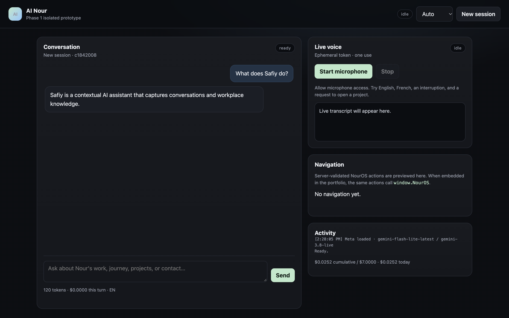
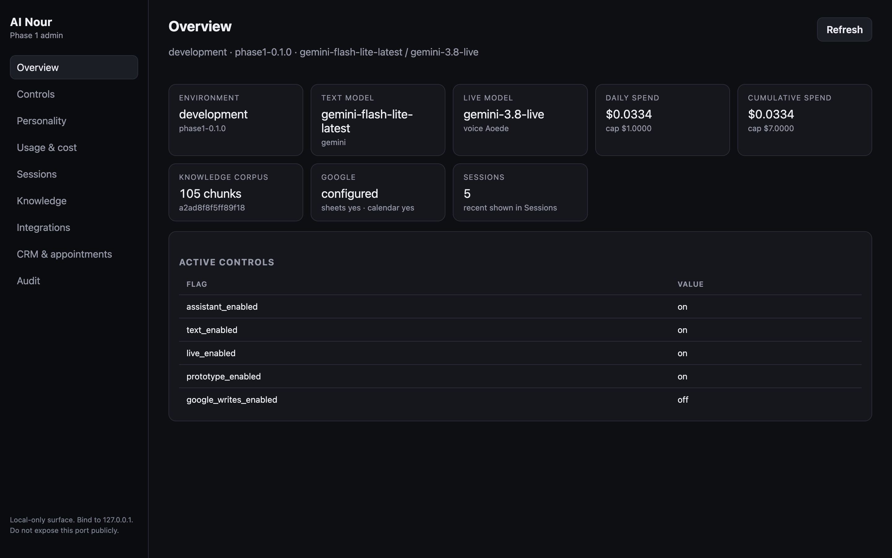

# Proposed visual directions — not final

The Phase 1 interface is a **temporary QA surface**, not a production design. It exists to test text, voice, recovery, navigation, and state handling. No portfolio CSS or production layout was changed.

## Temporary QA surface

- Two-column desktop layout: conversation workspace + Live voice / navigation / activity rail.
- Explicit connection states: `idle`, `connecting`, `listening`, `processing`, `speaking`, `error`.
- Visible budget and token counts.
- Navigation actions are previewed when the prototype is standalone; when embedded in the portfolio, the same validated action calls `window.NourOS`.
- A local-only admin surface is separate and never exposed in the portfolio.

The admin surface is deliberately utilitarian: local-only, token-proxied, read-mostly, and unsafe to expose publicly.

## Direction A — Quiet portfolio companion (recommended)

**Idea:** a small, persistent AI Nour presence inside the existing immersive portfolio rather than a separate chat product.

- **Entry:** a small glass capsule in the toolbar or lower-right corner, labelled “Ask AI Nour” with a subtle voice icon.
- **Collapsed:** one-line prompt / status; no permanent chat panel.
- **Expanded:** a floating conversation panel that uses the portfolio’s glass language, max ~420 px wide on desktop.
- **Voice:** a circular listening/speaking indicator with text fallback; the conversation panel expands only when needed.
- **Navigation:** when AI Nour opens a project or chapter, the panel collapses to a small “Opened Safiy” chip so the portfolio remains the primary surface.
- **States:** idle = quiet capsule; listening = pulse; processing = restrained progress line; speaking = waveform; error = plain text with retry.
- **Why:** preserves the portfolio as the product, keeps AI Nour discoverable, and avoids a second competing interface.
- **Risks:** voice in an immersive visual environment can feel intrusive; needs careful audio ducking and a persistent mute.

## Direction B — Conversation workspace (desktop-heavy)

**Idea:** a dedicated AI Nour workspace adjacent to the portfolio, for visitors who want to explore deeply.

- **Layout:** left rail = conversation; right rail = retrieved context cards + navigation history; portfolio remains available in a split view or new tab.
- **Best for:** recruiting, consulting discovery, and longer research conversations.
- **States:** explicit “reading portfolio…”, “opening project…”, “listening…”, “speaking…” indicators; a context drawer showing which public chunks informed the answer.
- **Why:** makes grounding and navigation legible; useful for demonstrating how AI Nour reasons over public work.
- **Risks:** too much chrome for casual visitors; should be an optional expanded mode, not the default.

## Direction C — Mobile voice sheet

**Idea:** a native-feeling bottom sheet that prioritizes voice on phones.

- **Layout:** bottom sheet with one large push-to-talk / continuous-listen control, current state, live transcript, and a compact text input.
- **States:** sheet handle + status ring; interrupt by tapping or speaking; transcript auto-scrolls but remains editable.
- **Why:** voice is the natural mobile interaction; the portfolio remains full-screen behind the sheet.
- **Risks:** browser autoplay/microphone policies; needs iOS Safari testing before commitment.

## Interaction rules for any direction

1. AI Nour never blocks portfolio navigation.
2. Every action is reversible; opening a project does not trap the visitor in chat.
3. Voice states are always visible; “listening” and “speaking” are never ambiguous.
4. Text is always available as a fallback.
5. Cost/usage is not shown to visitors; it belongs in admin.
6. The permanent API key never reaches the browser.
7. No automated email, booking, or external write is presented as completed without human confirmation.
8. The assistant identifies itself as AI Nour, not as Nour.

## Approval gates

- Choose Direction A, B, or C (or a hybrid).
- Approve typography, glass/contrast, motion, and mobile breakpoints.
- Approve the voice affordance and microphone permission copy.
- Approve how navigation results are surfaced.
- Only then implement the production visual layer. The current UI and CSS are disposable.
