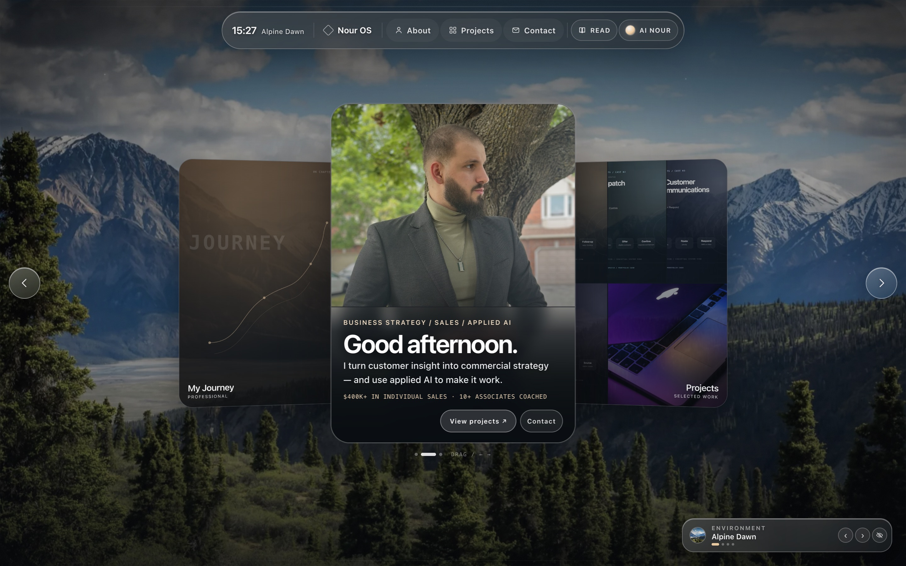
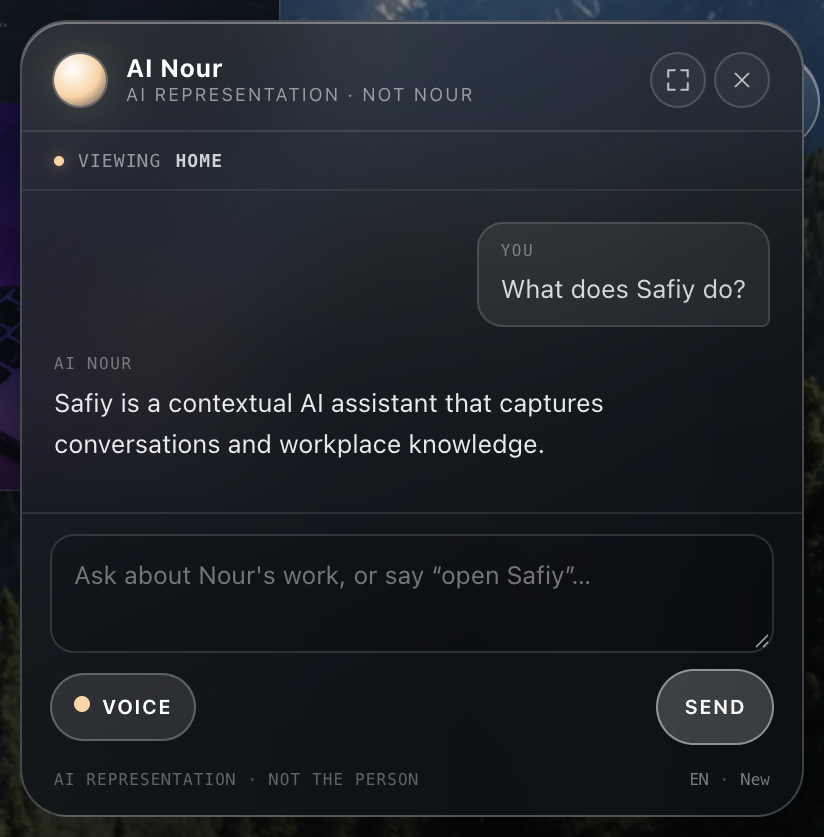
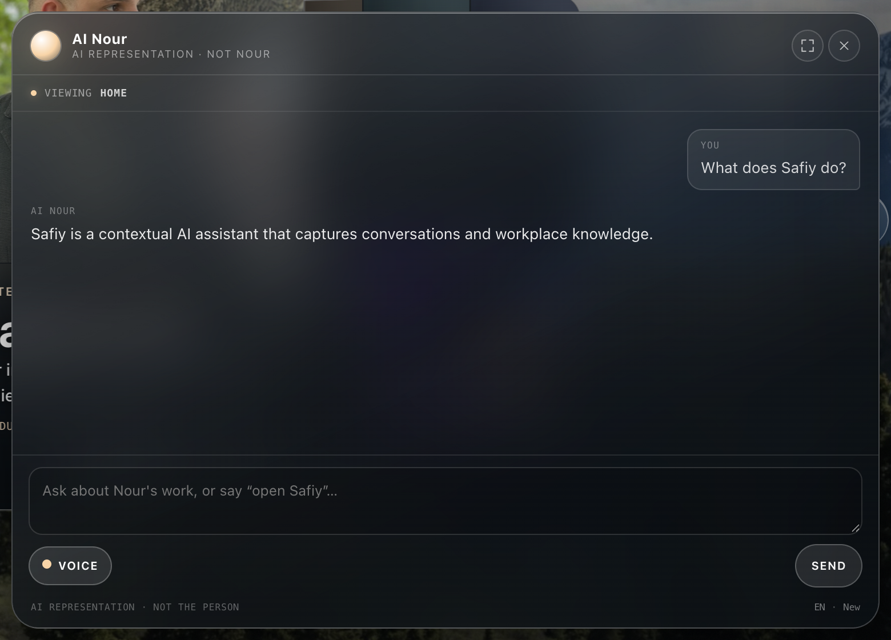
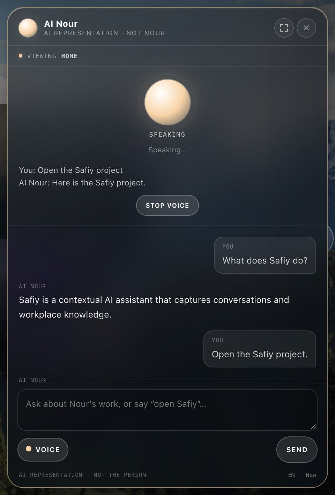
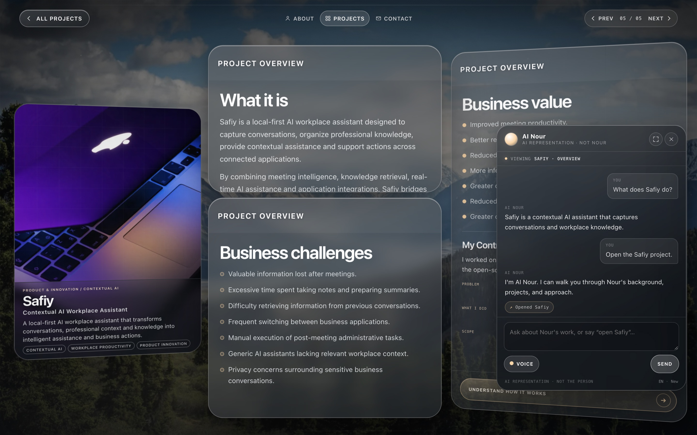

# AI Nour visual prototypes — Phase 2

Status: **integrated development prototype, not final production UI.** The companion is feature-flagged and only mounts when the portfolio is opened with `?ainour=dev` (or `?ainour=1`). The default portfolio and the reading view remain assistant-free.

## Integration URL

```text
http://localhost:8771/?ainour=dev&ainour-api=http://127.0.0.1:8792
```

The local mock Worker uses the test-only access key `phase2-test-key`; the production Worker uses the real key from `.dev.vars`. The companion is mounted by `src/ai-nour/companion.js`; no production CSS or layout was changed.

## Ambient presence



- A glass “AI Nour” button sits at the right end of the existing toolbar, between Read and the environment controls.
- The small orb is the only persistent visual cue; there is no floating chatbot bubble.
- The companion is closed by default. Existing portfolio navigation, cards, scenes and reading view are untouched.

## Compact conversation



- 392 px glass panel anchored bottom-right above the utility dock.
- AI messages use a thin accent rule rather than chat bubbles; user messages use small glass chips.
- Header includes the disclosure “AI representation · not Nour”.
- Context line shows the current portfolio section.
- The composer includes a Voice affordance and a language toggle.

## Expanded conversation



- 760 px workspace, same glass language, wider thread and more context.
- Intended for longer research or guided portfolio conversations.
- Expansion and collapse are explicit; the panel never covers the whole viewport.

## Voice conversation



- Active voice state uses a concentric orb with a state label: connecting, listening, processing, speaking, error.
- Transcripts appear in the voice sheet with user/AI labels.
- Stop voice is always available; text input remains usable below.
- The screenshot is a deterministic UI demo state (`AINourPrototype.demoVoice`) to show the visual treatment; it is not a live microphone capture.

## Navigation during conversation



- The model requested `openProject('safiy')`; the server validated the allowlisted id and the companion called `window.NourOS.openProject('safiy')`.
- The portfolio opened the Safiy project; the companion collapsed to compact and its context line changed to “Safiy · overview”.
- The action chip records “Opened Safiy” in the thread.
- **Manual navigation takes priority:** if the visitor navigates while the panel is expanded or voice is active, the panel collapses and voice stops. The AI never re-opens the panel over a manual route change.

## Mobile


- At 390×844 the panel becomes a bottom sheet: full width, top-rounded, safe-area aware.
- The toolbar trigger remains available; labels collapse to icons on narrow widths.
- The conversation remains usable with the virtual keyboard; voice and text switch without leaving the sheet.
- The mobile capture shows the restored conversation after a reload, confirming session recovery.

## Interaction rules

1. AI Nour never blocks portfolio navigation.
2. Every navigation action is reversible; the visitor remains in control.
3. Voice states are always visible; listening/speaking are never ambiguous.
4. Text is always available as a fallback.
5. AI Nour identifies itself as AI, not Nour.
6. No automated email, booking, or external write is presented as completed without the relevant confirmation.
7. The permanent Gemini key never reaches the browser; Live uses one-use ephemeral tokens.

## Proposed production directions

### Direction A — Quiet portfolio companion (implemented prototype, recommended)

The current integrated prototype. A toolbar presence plus compact/expanded/voice layers. Best fit for the existing spatial interface because it preserves the portfolio as the primary product.

### Direction B — Conversation workspace

A deeper desktop workspace with a context/navigation rail and a larger transcript. Still useful as an optional expansion of Direction A, not as the default.

### Direction C — Mobile voice sheet

A voice-first bottom sheet with a large push-to-talk/listening control. The current mobile sheet is the base; a future pass can make voice the dominant mobile interaction.

## Approval gates

- Approve Direction A as the production direction, or request changes to the ambient trigger/panel proportions.
- Approve the disclosure copy and the AI voice treatment.
- Approve mobile sheet behavior and the voice affordance.
- Approve whether the production panel is always available or gated behind a portfolio setting.
- Only then replace the temporary CSS with final visual tokens and motion.

The current implementation is intentionally reversible: removing the feature flag removes the companion entirely without affecting the portfolio.
