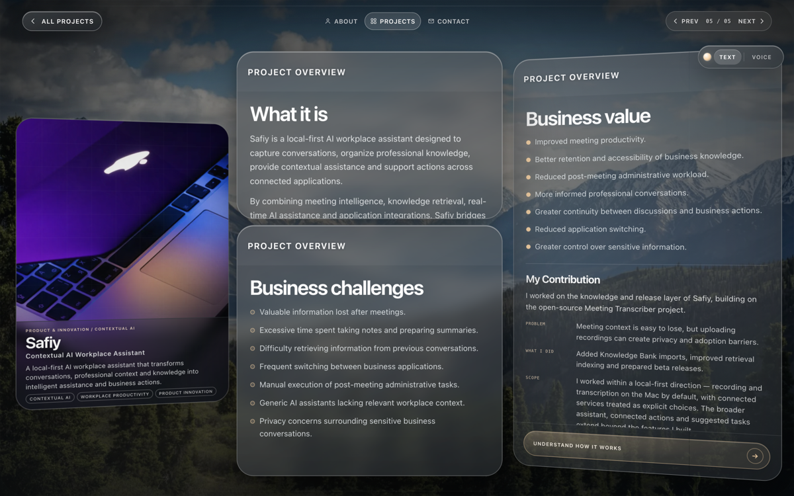

# AI Nour visual prototypes — Phase 2

Status: **integrated development prototype, not final production UI.** The companion is feature-flagged and only mounts when the portfolio is opened with `?ainour=dev` (or `?ainour=1`). The default portfolio and the reading view remain assistant-free.

## Integration URL

```text
http://localhost:8771/?ainour=dev&ainour-api=http://127.0.0.1:8792
```

The local mock Worker uses the test-only access key `phase2-test-key`; the production Worker uses the real key from `.dev.vars`. The companion is mounted by `src/ai-nour/companion.js`; no production CSS or layout was changed.

## Persistent top-right pill


- AI Nour is a standalone glass pill fixed at the top-right of every page. It is **not** in the menu bar or toolbar.
- The pill contains the orb, a **Text** button and a **Voice** button. The active mode is highlighted; a live dot and a subtle glow appear during voice, and unread replies are marked.
- The pill remains visible above project overlays and the visor, so the companion is reachable without leaving the current context.
- The panel is closed by default. Existing portfolio navigation, cards, scenes and reading view are untouched.

## Text mode

- Text opens a 390 px transparent glass panel at the top-right. The landscape and portfolio content remain visible through it.
- The panel is draggable by its header, clamped inside the viewport, and remembers its position.
- Two explicit sizes sit alongside the standard panel: **mini** (304×355) and **expanded** (760 px).
- AI messages use a thin accent rule rather than chat bubbles; user messages use small glass chips.
- Header includes the disclosure “AI representation · not Nour”; the context line shows the current portfolio section.
- The composer includes Voice, Send, EN/FR and New controls.
- Closing the panel hides the UI only; the conversation and session remain, and the pill marks unread replies.

## Thinking state


- While a text answer is being generated, a compact **Thinking** label glows with a pulsing accent dot.
- It is hidden when idle, is not a chat message, and respects `prefers-reduced-motion`.

## Voice mode


- Active voice state uses a concentric orb with a state label: connecting, listening, processing, speaking, error.
- Voice transcripts are appended **directly into the shared conversation thread**, with “You” and “AI Nour” labels. There is no separate transcript sheet, so text and voice history stay together.
- Stop voice is always available; text input remains usable below.
- **Closing the panel does not stop the session.** The microphone, Live connection and AI tool actions continue; the pill reflects listening/speaking and reopening Voice returns to the live panel. Start microphone is the only way to begin a new voice session, and Stop voice or New ends it.
- The screenshot is a deterministic UI demo state (`AINourPrototype.demoVoice`) to show the visual treatment; it is not a live microphone capture.

## Navigation during conversation



- The model requested `openProject('safiy')`; the server validated the allowlisted id and the companion called `window.NourOS.openProject('safiy')`.
- The portfolio opened the Safiy project, the context line changed to “Safiy · overview”, and the action chip records “Opened Safiy” in the thread.
- The AI Nour pill stays accessible above the project overlay. Navigation transitions that report `BUSY` are retried rather than forced.
- **Manual navigation takes priority:** AI Nour never blocks navigation and never re-opens a closed panel. Closing the panel during an active voice session leaves the session running rather than ending it.

## Mobile


- At 390×844 the panel becomes a bottom sheet: full width, top-rounded, safe-area aware.
- The top-right pill remains available; labels stay compact.
- The conversation remains usable with the virtual keyboard; voice and text switch without leaving the sheet.
- The mobile capture shows the restored conversation after a reload, confirming session recovery.

## Interaction rules

1. AI Nour never blocks portfolio navigation.
2. Manual navigation takes priority; AI actions never block navigation or re-open a closed panel.
3. Closing the panel hides the UI only. It never ends a text or voice session; only Stop voice or New ends voice.
4. Voice states are always visible in the panel and the pill; listening/speaking are never ambiguous.
5. Text is always available as a fallback.
6. AI Nour identifies itself as AI, not Nour.
7. No automated email, booking, or external write is presented as completed without the relevant confirmation.
8. The permanent Gemini key never reaches the browser; Live uses one-use ephemeral tokens.

## Proposed production directions

### Direction A — Quiet portfolio companion (implemented prototype, recommended)

The current integrated prototype. A persistent top-right pill plus a movable, resizable text/voice panel. Best fit for the existing spatial interface because it preserves the portfolio as the primary product.

### Direction B — Conversation workspace

A deeper desktop workspace with a context/navigation rail and a larger transcript. Still useful as an optional expansion of Direction A, not as the default.

### Direction C — Mobile voice sheet

A voice-first bottom sheet with a large push-to-talk/listening control. The current mobile sheet is the base; a future pass can make voice the dominant mobile interaction.

## Approval gates

- Approve Direction A as the production direction, or request changes to the top-right pill, panel transparency, movement, or sizes.
- Approve the glowing Thinking treatment and the in-chat voice transcript.
- Approve closing the panel without stopping the text/voice session.
- Approve the disclosure copy and the AI voice treatment.
- Approve mobile sheet behavior and the voice affordance.
- Approve whether the production pill is always available or gated behind a portfolio setting.
- Only then replace the temporary CSS with final visual tokens and motion.

The current implementation is intentionally reversible: removing the feature flag removes the companion entirely without affecting the portfolio.
