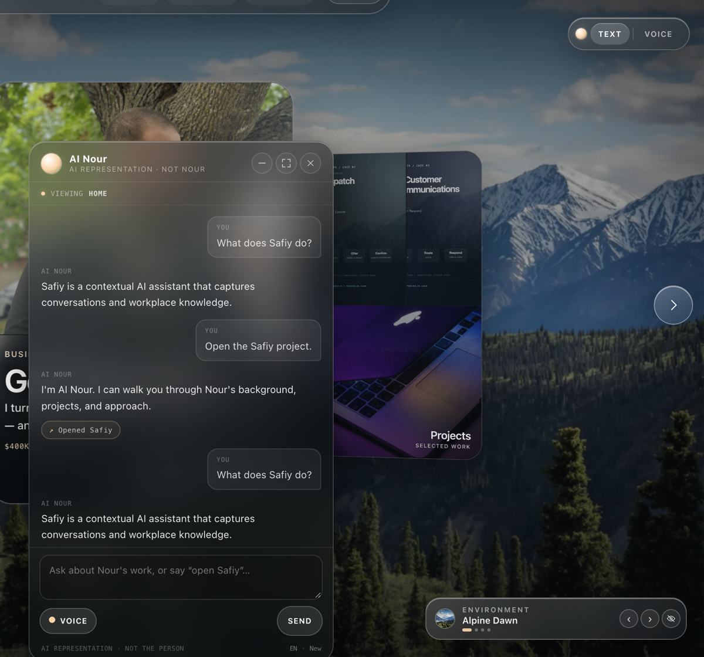
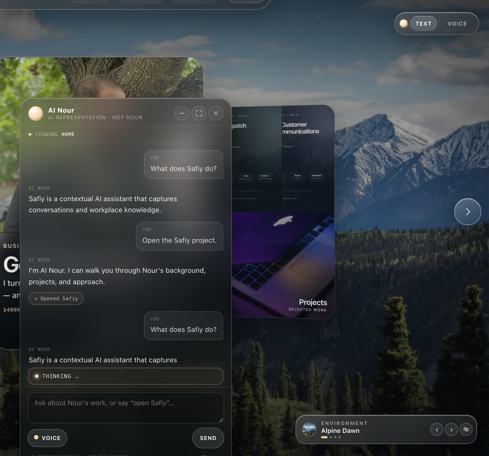
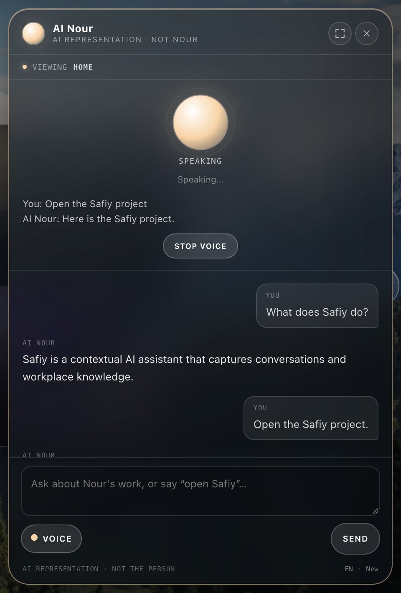
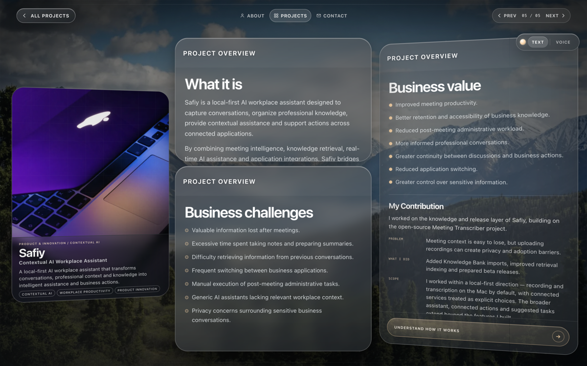
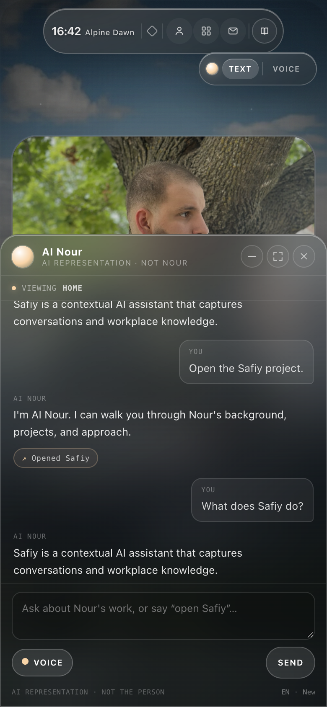

# AI Nour — Phase 2 Visual Integration and Production Hardening

**Date:** 26 November 2026  
**Branch:** `phase2/ai-nour-production`  
**Worktree:** `ai-nour-phase2/`  
**Upstream merge:** `origin/main` at `8a08769` → merge commit `6d6f3f1`  
**Status:** Integrated development prototype complete; **Conditional GO for Phase 3 production integration**, not a production launch.

**Phase 3 continuation:** operational email, CRM approval package, production OAuth, admin hardening, Live-spend analysis, the six-state visual package, and current costs are in `docs/ai-nour-phase3.md`. Cost figures in this Phase 2 report are historical.

---

## 1. Executive summary

Phase 2 turned the functional Phase 1 prototype into an integrated, feature-flagged Nour OS companion and hardened the surrounding backend.

- The quiet-companion direction is implemented as a standalone top-right pill with text and voice modes, a movable transparent panel, a glowing Thinking state, and close-without-ending-the-session behavior.
- The knowledge corpus was regenerated from the latest `origin/main` content; retrieval is now **87.27% top-1 / 100% top-3** over 55 bilingual queries.
- CRM, consent, inquiry, appointment, reschedule, cancel, ownership, idempotency and concurrency workflows are implemented and tested.
- A real synthetic Google Calendar appointment produced a unique Meet link, was rescheduled, cancelled, and left no attendee invite.
- Administrator Google OAuth is live locally: Google sign-in, email allowlist, signed HttpOnly session, reload persistence, and unauthorized API rejection were verified.
- Live tokens now carry a prepaid server-side reservation; a browser cannot mint a second token once the remaining cap cannot cover the reservation, even if it never reports usage.
- No fixed infrastructure cost was introduced. The evaluation budget remains intact.

**Current cost:** $0.278328 USD actual spent / **~$0.3958 CAD**; $0.358328 USD committed including an $0.08 held Live reservation / **~$0.5095 CAD**.

---

## 2. Upstream integration

`origin/main` had advanced from the Phase 0A base to `8a08769`:

- `8ac9cb9` — portfolio positioning, readability and intro changes.
- `8a08769` — Cloudflare Pages production deployment at `nourchkair.com`.

A dedicated Phase 2 worktree was created from the Phase 1 branch and `origin/main` was merged into it at `6d6f3f1`. The only conflict was `.gitignore`, resolved by keeping `.wrangler/` and `tools/phase0a/audio/`. **No merge was made into `main` and nothing was pushed.**

Post-merge work:

- The corpus was regenerated from the latest `journey.js`, `profile.js`, `site.js`, and `projects.js`.
- New `PROFESSIONAL_TAGLINE`, `PROFILE_POSITIONING`, `PROFILE_INTERSECTION`, and `PROFILE_PROOF` content was added to the corpus.
- Corpus: **107 chunks**.
- The NourOS command API and `src/data/projects.js` were unchanged, so integration remained stable.
- The root portfolio validation still passes **261 checks**.
- `npm test` in `ai-nour` passes after the merge.

---

## 3. Visual prototypes — Direction A

The quiet portfolio companion is implemented as a feature-flagged layer:

```text
http://localhost:8771/?ainour=dev&ainour-api=http://127.0.0.1:8789
```

It mounts only with `?ainour=dev` or `?ainour=1`; the default portfolio and the reading view remain assistant-free.

### Persistent top-right pill



- AI Nour is **not part of the menu bar**. A standalone glass pill is fixed at the top-right of every page, outside the toolbar.
- The pill contains the orb, a **Text** button and a **Voice** button. It is the only persistent visual cue; there is no generic floating chatbot bubble.
- The pill remains visible above project overlays and the visor, and reflects the active mode, an active Live session, and unread replies.
- The panel is closed by default. Opening Text or Voice expands the panel from the pill.

### Text mode

- Text opens a 390 px transparent glass panel at the top-right. The landscape and portfolio content remain visible through it.
- The panel can be dragged by its header, is clamped inside the viewport, and remembers its position. It can be minimized to 304×355 or expanded to 760 px.
- AI responses use a thin accent rule; user turns use small glass chips. The disclosure “AI representation · not Nour” and the current portfolio context stay visible.
- Voice, EN/FR, New, minimize, expand and close controls remain available.
- Closing the panel hides the UI only. The conversation, session and any active voice connection continue; the pill remains and marks unread replies.

### Thinking state



- While a text request is in flight, a compact **Thinking** label glows with a pulsing accent dot.
- The label is hidden when idle and respects `prefers-reduced-motion`; it is a state indicator, not a separate message.

### Voice mode



- The voice panel uses a concentric orb with explicit states: connecting, listening, processing, speaking, error.
- Voice transcripts stream **directly into the shared conversation thread**, with “You” and “AI Nour” labels. There is no separate transcript sheet, so the text and voice history stay together.
- Start microphone and Stop voice are explicit controls; the text composer remains available below.
- **Closing the panel does not stop the session.** The microphone, Live connection and AI tool actions keep running; the pill reflects listening/speaking and reopening Voice returns to the live panel.
- This screenshot is a deterministic visual demo state; the real microphone path is covered by the human test plan.

### Navigation during conversation



- “Open the Safiy project” produced the server-validated `openProject: safiy` action.
- The companion called `window.NourOS.openProject('safiy')`; the project overlay opened at `#/projects/safiy` and the context changed to “Safiy · overview”.
- The AI Nour pill stays accessible above the project overlay. Navigation transitions that report `BUSY` are retried rather than forced.
- Manual visitor navigation takes priority: AI Nour never blocks navigation and never re-opens a closed panel.

### Mobile



- At 390×844 the panel becomes a bottom sheet with safe-area awareness; the top-right pill stays available.
- The conversation remains usable with the virtual keyboard; voice and text switch without leaving the sheet.
- The conversation restores after reload.

### Proposed direction

Direction A is implemented and recommended for production. Direction B (larger workspace) and Direction C (voice-first mobile) remain optional expansions. Full rationale and approval gates: `ai-nour/docs/visual-prototypes.md`.

**No production CSS or layout was changed.** Removing the feature flag removes the companion entirely.

---

## 4. Integrated experience

- Text chat with grounded portfolio answers.
- Real-time Live voice with one-use ephemeral tokens.
- English and Canadian French.
- Shared text/voice D1 context and recovery.
- Portfolio-context awareness: current section, project, flow, journey chapter, and route are passed to the server, validated, and included in the prompt/retrieval.
- Server-validated navigation tools: `openSection`, `openProject`, `openProjectFlow`, `openJourneyChapter`, `openContact`, and `presentProject`.
- Manual visitor navigation always wins; AI actions never re-open over a manual route change.
- Visible connection, listening, processing and speaking states.
- Clear AI disclosure.
- The reading page remains assistant-free.

---

## 5. Backend and administration

### Backend

- Modular Worker modules for auth, sessions, retrieval, tools, providers, cost, controls, Google, CRM and email.
- D1 migrations `0002_phase2.sql` and `0003_crm_idempotency.sql`.
- New tables: contacts, consents, inquiries, email jobs, live-token reservations; extended bookings.
- Runtime context validation (`knowledge/context.js`) and context-aware retrieval/prompting.
- Guided project presentation action with server-side project validation.
- Prepaid Live-token reservation and reconciliation.
- CRM service with:
  - consent and contact creation;
  - inquiry classification and idempotency;
  - availability from D1 + Google free/busy;
  - appointment reservation, ownership, overlap and idempotency;
  - unique Meet link via Google Calendar;
  - reschedule, cancel, reconcile-on-calendar-failure;
  - email job creation for acknowledgement, confirmation, reschedule and cancellation.
- Email service with Resend and Gmail-draft adapters; `EMAIL_SEND_ENABLED=false` by default.

### Administration

- Google OAuth administrator login verified locally:
  - `GET /` → `/auth/google/start` → Google → `/auth/google/callback` → `/`.
  - Email allowlist `nourchkair@gmail.com`.
  - HMAC-signed HttpOnly session cookie.
  - Reload keeps the session; `/api/admin/status` without the cookie returns 401.
- The existing Google OAuth client received the additional localhost redirect URI `http://127.0.0.1:8791/auth/google/callback`; the existing 8787 URI was preserved. The app remains in **Testing**; no publishing or verification was submitted.
- Admin views: Overview, Controls, Personality, Usage & cost, Sessions, Knowledge, Integrations, CRM & appointments, Audit.
- CRM view now includes inquiries, D1 appointments, email jobs and a dry-run processing button.
- Feature flags, emergency shutdown, persona editing, cost ledger and integration status remain server-side.
- Model configuration is surfaced read-only in Phase 2; model changes remain environment-managed.

---

## 6. CRM and appointments

Proposed Google Sheets schema: `ai-nour/crm-schema.phase2.json` and `ai-nour/docs/crm-schema.md`. **Not applied**; no production headers or records were written.

D1 workflow tests (`results/crm-tests.json`) — **14/14**:

- Inquiry + contact + consent created.
- Inquiry idempotency.
- Availability endpoint.
- Appointment reserved in D1.
- Appointment idempotency.
- Concurrent same-slot booking: one winner, one 409.
- Wrong-owner cancel: 404.
- Reschedule.
- Owner cancel.
- Cancelled slot rebooked.
- Owner sees only own inquiries.
- Admin sees inquiries and appointments.
- Email jobs queue and process as dry runs.

Real Google Calendar synthetic test (`results/crm-google-tests.json`) — **10/10**:

- Google writes enabled only for the synthetic test.
- Appointment confirmed with unique Meet link.
- Calendar event created in `America/Toronto`.
- No attendees.
- Rescheduled; calendar moved.
- Cancelled; calendar event returned status `cancelled` / deleted.
- Confirmation, reschedule and cancellation email jobs queued.
- Google writes disabled again after the test.

No real email was sent and no real attendee was invited.

---

## 7. Communications

Recommendation: **Resend Free** for automated acknowledgements, confirmations, reminders, reschedules and cancellations; Gmail drafts + human send for conversational replies.

Current facts (November 2026):

- Resend Free: $0, 3,000 transactional emails/month, 100/day, 3 verified domains, no credit card, 30-day retention.
- Requires a verified sending domain and DNS records.
- Gmail `gmail.send` is sensitive; `gmail.compose` is restricted and triggers a security assessment.
- Gmail MCP has no send tool; Google’s agent policy requires MCP/CLI and human confirmation from February 2027.
- Resend avoids the Gmail restricted-scope assessment and keeps the fixed cost at $0.

Prepared but inactive: `email_jobs` table, Resend/Gmail-draft adapters, admin dry-run processor. `EMAIL_SEND_ENABLED=false`; no Resend key or domain DNS was configured.

Full recommendation: `ai-nour/docs/email-recommendation.md`.

---

## 8. OAuth production readiness

Prepared: `ai-nour/docs/oauth-production-readiness.md`, `ai-nour/oauth/privacy.html`, `ai-nour/oauth/terms.html`.

Recommended production scope set:

- `spreadsheets`
- `calendar.events`
- `calendar.readonly`
- `drive.file`
- `openid email profile` for the separate admin client
- **Omit Gmail scopes** if Resend handles automated email; add `gmail.compose` only if drafts are required and the restricted-scope assessment is approved.

Production redirect URIs proposed:

- `https://admin.nourchkair.com/auth/google/callback` (private/Access-protected)
- `https://api.nourchkair.com/oauth/google/callback` (Worker/custom domain required)
- Local admin: `http://127.0.0.1:8791/auth/google/callback` (verified)
- Existing local helper: `http://localhost:8787/oauth/google/callback` (preserved)

Still unresolved: app remains in Testing; refresh tokens can expire after 7 days; publishing/verification was not submitted; production admin/API hostnames and DNS are not configured; privacy/terms pages are drafts and must be published and linked before verification.

---

## 9. Security and regression results

| Test | Result | Evidence |
| --- | --- | --- |
| Unit tests | **38/38** | `results/unit-tests.txt` |
| Mock-provider API | **23/23** | `results/api-tests.json` |
| Endpoint security | **8/8** | `results/security-api.json` |
| CRM workflow | **14/14** | `results/crm-tests.json` |
| Real Google CRM | **10/10** | `results/crm-google-tests.json` |
| Live budget bypass | **3/3** | `results/live-budget-tests.json` |
| Real text + Live | **12/12** | `results/real-smoke.json` |
| Real French text + Live | **7/7** | `results/real-french.json` |
| Recovery | **4/4** | `results/recovery-test.json` |
| Retrieval | **87.27% top-1 / 100% top-3** | `results/retrieval-benchmark.json` |
| Secret scan | **364 files, 0 hits** | pattern scan plus 8 active secret values; excludes ignored `.dev.vars` |
| Portfolio regression | **261 checks** | root `npm test` |
| Companion UI QA | **9/9** | `results/ui-integration-tests.json`; mock Worker, 1440×900 and 390×844 |

Coverage includes:

- Prompt injection and indirect retrieved-content override.
- Unauthorized tool execution and path traversal.
- Cross-session and cross-owner access.
- Admin authentication bypass.
- Booking concurrency and ownership.
- Duplicate chat, Live-turn and appointment actions.
- External provider failure (503) and recovery.
- Session recovery.
- Spending-limit bypass via unreported Live usage.
- Credential exposure scan.

### Live-token bypass control

A Live token carries a prepaid reservation (`$0.08 USD` by default for a 120-second token). Held reservations count toward daily and cumulative caps. If the browser never reports usage, the reservation remains charged; if it does report, the server charges `max(actual, reservation)`. The test issued one token under a $1 cap and confirmed the second token returns **402** before any usage was reported.

Residual risk: this bounds token-level economics but is not a full audio proxy. A malicious client could underreport usage within a token; the reservation floor limits the exposure. A server-side WebSocket proxy is the Phase 3 option if exact per-second metering is required.

### Other residual risks

- Admin API is bearer-token protected but publicly routable if deployed; Access/private networking is required.
- OAuth remains Testing; 7-day refresh-token expiry.
- D1 is ENAM/ORD, not Canada.
- The archived third-party Google Maps key remains in git history at `4c61dd0`; current tree is redacted. Do not rewrite history without approval.
- Real microphone/Bluetooth/iOS behaviour still requires human testing.

---

## 10. Real-device testing

Instructions: `ai-nour/docs/real-device-testing.md`.

Requires your participation for:

- Desktop Chrome microphone/audio.
- Desktop Safari microphone/audio.
- iOS Safari over HTTPS (tunnel or approved dev preview), including permissions, playback, Bluetooth routing, interruption, reconnection, French pronunciation and latency.
- Visual approval of the companion on the target devices.

Automated tests covered the server, UI state machine, navigation and mock voice visuals; they did not exercise a real microphone or Bluetooth path.

---

## 11. Actual costs

Rates are list prices; no invoice has been issued.

| Item | USD micros | USD | CAD at 1.4219 |
| --- | ---: | ---: | ---: |
| Phase 0A + Phase 1 carryover | 34,559 | $0.034559 | $0.04914 |
| Phase 2 actual spent | 243,769 | $0.243769 | $0.3466 |
| **Actual spent total** | **278,328** | **$0.278328** | **~$0.3958** |
| Held Live reservation | 80,000 | $0.080000 | $0.1138 |
| **Committed total** | **358,328** | **$0.358328** | **~$0.5095** |

- Fixed infrastructure: **$0/month**.
- Approved evaluation budget: **$10 CAD**.
- Daily cap: **$1.00 USD**; cumulative cap: **$7.00 USD** (~$9.95 CAD).
- Remaining committed cap: ~**$9.44 CAD**; actual-spend headroom under the $10 CAD approval: ~**$9.60 CAD**.
- No billing, subscription, R2, paid auth, paid database, or paid email service was activated.

The Phase 2 cost is dominated by three charged Live reservations at $0.08 each (English, French, and an additional Live check), plus one outstanding $0.08 hold and text/security usage. The held reservation is released after its window if unused. Charged reservations remain counted even when the browser reports no usage.

---

## 12. Remaining blockers and approvals

### Requires your decision/authorization

1. **Visual approval:** approve Direction A, or request changes to the top-right pill, panel transparency/movement, Thinking treatment, in-chat voice transcript, close-without-stopping behavior, disclosure, or mobile sheet.
2. **OAuth publishing:** approve publishing/verification and any restricted-scope assessment, or keep the app in Testing and accept 7-day reauthorization.
3. **Admin exposure:** keep the admin local/private, or approve a production admin hostname and Access/private networking.
4. **Resend setup:** approve a sending subdomain (`mail.nourchkair.com` or similar) and DNS records; provide a Resend API key only if that path is chosen.
5. **CRM schema:** approve `ai-nour/docs/crm-schema.md` before applying headers to the live Google Sheet.
6. **Real-device testing:** run the Chrome/Safari/iOS checklist.
7. **Third-party key history:** clean history or confirm the archived Google Maps key was revoked.
8. **D1 residency:** accept ENAM/ORD or change providers.

### Engineering follow-ups for Phase 3

- Add a server-side Live WebSocket proxy if exact per-second metering is required.
- Add production Access/private admin routing.
- Add runtime model selection if needed (currently read-only/environment-managed).
- Add knowledge-override application and admin editing.
- Add observability/export within free-tier limits.
- Add long-conversation summary and recovery tests with the production model.
- Add real-device regression captures.

---

## 13. Files and resources

### Created/modified in Phase 2

```text
src/ai-nour/
  companion.js
  companion.css
  vendor/genai.js
src/main.js                         feature-flagged companion import
ai-nour/
  migrations/0002_phase2.sql
  migrations/0003_crm_idempotency.sql
  src/knowledge/context.js
  src/services/crm.js
  src/integrations/email/index.js
  src/routes/crm.js
  admin/*                           CRM/email views + Phase 2 title
  scripts/build-companion-sdk.mjs
  scripts/test-crm.mjs
  scripts/test-crm-google.mjs
  scripts/test-live-budget.mjs
  scripts/real-french.mjs
  docs/visual-prototypes.md
  docs/crm-schema.md
  docs/oauth-production-readiness.md
  docs/email-recommendation.md
  docs/real-device-testing.md
  docs/screenshots/phase2-companion-*.png
  results/*
  crm-schema.phase2.json
  oauth/privacy.html
  oauth/terms.html
docs/ai-nour-phase2.md               this report
```

### Resources

- Local D1 `ai-nour-phase1-dev` retained for continuity; Phase 2 migrations applied locally.
- No remote Phase 2 Worker/Pages deployment.
- Google CRM spreadsheet, calendar and Drive folders remain the Phase 0A resources.
- No R2; no Cloudflare Access organization; no Resend account/domain configured.
- Local admin Google OAuth client remains in Testing; one localhost redirect URI added.

### Git

- Branch `phase2/ai-nour-production` in `ai-nour-phase2/`.
- Upstream merge commit `6d6f3f1`.
- No merge into `main`, no push, no production deployment.
- `main` and the other session’s work remain untouched.

---

## 14. Phase 3 readiness

**Conditional GO for Phase 3 production integration.** The integrated prototype is ready for visual approval and real-device testing. Production launch is gated on the decisions in section 12.

Recommended Phase 3 sequence:

1. Approve the visual direction and apply final production CSS/motion.
2. Complete real-device Chrome/Safari/iOS testing.
3. Publish/verify OAuth; remove Gmail scopes if Resend is approved.
4. Configure Resend domain and enable transactional email in dry-run → test → live.
5. Apply the approved CRM schema and connect the D1 workflow to the live Sheet.
6. Put the admin behind Access/private networking.
7. Decide whether exact Live metering requires a server-side proxy.
8. Run a production-readiness security review and cost review.

Phase 3 should not begin public traffic until the admin surface is private, OAuth is no longer in Testing, the CRM/email approvals are recorded, and the device tests pass.
